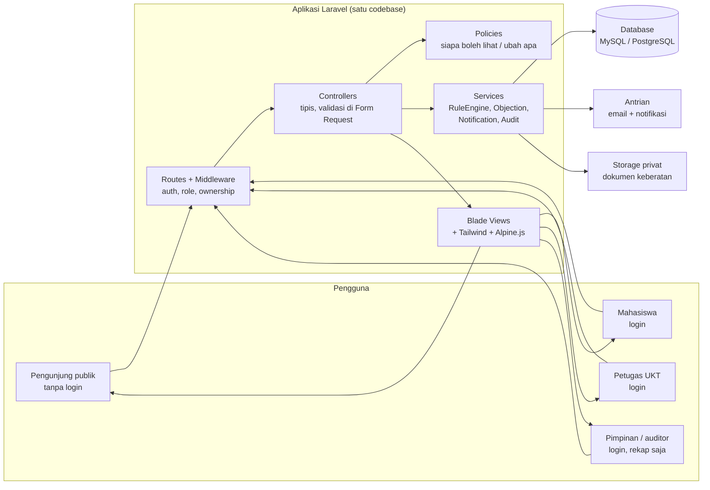

# Blueprint — Gambaran Besar Arsitektur Sistem

## Sistem Peninjauan dan Pengajuan Keberatan UKT Universitas Negeri Gorontalo

**Institusi:** Universitas Negeri Gorontalo (UNG)
**Singkatan:** SPPK-UKT UNG — penyebutan singkat sistem ini
**Produk:** SPPK-UKT UNG — Sistem Peninjauan dan Pengajuan Keberatan UKT Universitas Negeri Gorontalo (definisi lengkap di `PRD.md`)
**Stack yang ditetapkan:** Laravel + Blade + Tailwind CSS + Alpine.js
**Desain yang ditetapkan:** Light glassmorphism, profesional, simple, tegas
(lihat `Glassmorphism.md` dan `Motion.md`)
**Status dokumen:** Draf v1.0, pendamping `PRD.md`
**Bahasa dokumen:** Bahasa Indonesia

**Cara memakai dokumen ini:** Dokumen ini menjawab *bagaimana* sistem
dibangun dan *bagaimana tiap fitur di PRD bekerja*, dari halaman yang
dilihat pengguna sampai tabel database dan alur di server. Dokumen ini
berdiri sendiri untuk urusan arsitektur: definisi fungsi, alasan, dan
kriteria penerimaannya ada di `PRD.md`, tetapi pemetaan fitur ke modul,
halaman, dan alur di sini ditulis lengkap supaya pembaca tidak harus
membuka PRD untuk memahami gambaran besarnya. File yang menyertainya
adalah `PRD.md`, `Glassmorphism.md`, `Motion.md`, `AGENTS.md`, `DESIGN.md`, dan
`LOGO UNG (1).png`. Bila ada hal yang
tidak diatur di sini atau di file penyerta tersebut, ikuti spesifikasi
sistem yang diberikan bersama tugas — jangan mencari sumber arsitektur
lain di luar daftar itu.

> \*\*Batas yang sama dengan PRD, diulang di sini supaya tidak hilang saat
> dokumen ini dibaca terpisah:**&#32;Sistem ini \*\*bukan** penentu resmi
> golongan UKT. Formula, variabel, bobot, dan ambang resmi kampus belum
> diketahui dan tidak diasumsikan. Mesin penilaian adalah model penjelasan
> / simulasi berparameter yang langkahnya bisa ditelusuri. Untuk versi
> prototipe seeder ini, status simulasi/seeder dijelaskan di footer
> halaman hasil, bukan diulang di tiap baris data — keputusan pemilik
> produk, dengan konsekuensi bahwa tangkapan layar atau cetakan tanpa
> footer tidak membawa penjelasan itu. Bila data resmi masuk,
> penempatan penjelasan ini ditinjau ulang.
> Pembayaran UKT, perubahan data ekonomi yang sudah diverifikasi, akun
> orang tua, dan integrasi otomatis ke sistem kampus **tidak** dibangun
> di versi ini.

---

## 1. Gambaran Besar dalam Satu Gambar

Sistem ini adalah **satu aplikasi web monolitik Laravel** (bukan SPA,
bukan microservices). Browser meminta halaman, server Laravel memeriksa
peran dan kepemilikan data, mengambil data dari database, menghitung
bila perlu lewat layanan mesin penilaian, lalu me-render Blade.
Interaktivitas ringan (dropdown, modal, tab, accordion, toggle) ditangani
Alpine.js di browser. Pemberitahuan email dikirim lewat antrian, bukan
di tengah request pengguna.



Alur baca yang paling penting untuk dipahami dulu:

1. **Publik membaca tanpa login** — hanya konten umum (alur, faktor,
   rentang golongan, prosedur keberatan). Tidak ada query data pribadi
   di rute ini sama sekali.
2. **Mahasiswa login, melihat miliknya sendiri** — setiap query hasil,
   rincian, keberatan, dan pertanyaan dibatasi ke `mahasiswa_id` milik
   pengguna yang login, dan diperiksa lagi oleh Policy.
3. **Petugas bekerja dari daftar** — daftar keberatan dan pertanyaan
   yang masuk, detail satu pengajuan, ubah status dengan catatan,
   kelola konten publik, parameter, dan rentang golongan.
4. **Semua perubahan penting tercatat** — status, parameter, dan rincian
   yang diubah petugas masuk ke `audit_logs` dan memicu notifikasi yang
   relevan.

---

## 2. Keputusan Arsitektur Utama dan Alasannya

| Keputusan | Dipilih | Alasan | Yang ditolak dan alasannya |
| --- | --- | --- | --- |
| Bentuk aplikasi | Monolitik Laravel, Blade SSR | Sesuai stack yang ditetapkan; satu codebase lebih mudah diuji, di-deploy, dan dipelihara tim kecil; halaman publik mudah diindeks dan dibuka tanpa JavaScript berat | SPA terpisah (React/Vue) — menambah dua codebase, autentikasi ganda, dan kerumitan tanpa kebutuhan interaktivitas seberat itu |
| Rendering | Server-side Blade + Alpine.js untuk interaksi ringan | Sebagian besar layar adalah tabel, form, dan detail — pola yang paling cocok untuk Blade; Alpine cukup untuk dropdown/modal/tab | Livewire / Inertia sebagai lapisan utama — tidak ditetapkan di stack, dan tidak diperlukan untuk mencapai PRD |
| Autentikasi | Akun sistem sendiri (email + kata sandi, hash modern) | Tidak ada bukti SSO kampus tersedia di PRD; mengasumsikan SSO akan mengunci pembangunan pada integrasi yang belum diputuskan | SSO kampus — ditunda sampai kampus menetapkan penyedianya (lihat Bagian 14) |
| Otorisasi | Policy Laravel + pembatasan query per peran dan kepemilikan | Menegakkan matriks PRD di sisi server, bukan hanya menyembunyikan tombol | Hanya menyembunyikan menu di Blade — tidak aman, dan dilarang oleh PRD KF-12 |
| Mesin penilaian | Service berparameter, berversi, deterministik | Memenuhi KN-06 (aturan bisa diubah tanpa mengubah program) dan KN-04 (hasil lama bisa ditelusuri ke versi parameternya) | Rumus hard-code di controller — setiap perubahan aturan butuh deploy kode dan merusak keterlacakan hasil lama |
| Pemberitahuan | Antrian Laravel (queue) + mail + notifikasi database | Perubahan status tidak boleh gagal hanya karena email gagal; kegagalan bisa dicoba ulang dan terlihat petugas | Kirim email sinkron di request — memperlambat respons dan menyembunyikan kegagalan |
| Dokumen | Storage privat, diakses lewat controller berotorisasi | Dokumen keberatan adalah data pribadi; URL publik langsung adalah kebocoran | Storage publik — ditolak tegas |
| Database | Relasional (MySQL atau PostgreSQL, satu pilihan per deployment) | Data ini sangat relasional: mahasiswa–hasil–rincian–keberatan–riwayat, dengan integritas referensial | NoSQL dokumen bebas — mempersulit query kepemilikan, audit, dan konsistensi perhitungan |

---

## 3. Peta Modul

Satu modul = satu tanggung jawab. Controller tetap tipis; logika bisnis
tinggal di Service; aturan siapa boleh apa tinggal di Policy.

| Modul | Tanggung jawab | Fitur PRD yang dilayani |
| --- | --- | --- |
| Auth & Akun | Login/logout, kata sandi, sesi, peran | KF-12 |
| Konten Publik | Alur, faktor, rentang golongan, prosedur, panduan, kontak (opsional) | KF-02 (umum), KF-03 (umum), KF-06, KF-14, KF-10 |
| Hasil & Rincian | Hasil mahasiswa, tabel rincian, kalimat alasan | KF-01, KF-04 |
| Mesin Penilaian | Parameter berversi, perhitungan, jejak langkah | KF-05, KN-04, KN-06 |
| Keberatan | Formulir, dokumen, status, tanggapan petugas | KF-07 |
| Pertanyaan | Kirim pertanyaan, jawaban petugas, status | KF-08 |
| Panduan Pengisian | Petunjuk di dekat field, teks yang dikelola petugas | KF-09 |
| Pemberitahuan | Email + notifikasi di sistem lewat antrian | KF-15 |
| Riwayat & Audit | Log akses/perubahan, versi parameter | KF-13 |
| Rekap Pimpinan | Agregat tanpa data ekonomi perorangan (default) | Bagian 3 PRD (rekap) |
| Perkiraan Waktu | Teks perkiraan + sumber + tanggal, bila ditetapkan | KF-11 |

---

## 4. Front-End — Halaman, Layout, dan Komponen

### 4.1 Layout dan navigasi

- **Desktop-first, sidebar kiri** (sesuai `Glassmorphism.md`): desain
  utama dibuat untuk lebar 1280px ke atas, lalu disesuaikan ke bawah.
- **Sidebar atas:** logo dari `LOGO UNG (1).png` berdampingan dengan
  teks lengkap `Universitas Negeri Gorontalo`. Logo tidak diwarnai ulang
  dan selalu di atas permukaan terang. Di sidebar yang diciutkan, logo
  tetap memakai teks alternatif lengkap untuk aksesibilitas.
- **Header halaman:** judul halaman, aksi utama halaman itu, dan lonceng
  notifikasi untuk pengguna login. Satu halaman punya satu tugas utama
  yang dominan; konten sekunder dipindah ke tab atau halaman detail.
- **Tablet (768–1279px):** sidebar menjadi rail ikon atau drawer.
- **Mobile (<768px):** sidebar menjadi drawer; tabel menjadi kartu
  (judul, status, 1–2 field kunci, menu aksi); filter masuk ke panel.
- **Token visual** (nilai lengkap di `Glassmorphism.md`): primer
  `#f8f8f7`, sekunder `#550b14`, highlight `#F5B301`, radius tombol/input
  10px, kartu/modal 16px, permukaan kaca putih transparan + backdrop-blur 16px kartu / 24px modal, tanpa bayangan ganda neumorphism, font
  Poppins untuk heading dan Inter untuk body.
- **Motion** (nilai lengkap di `Motion.md`): hover 150ms, tekan tombol
  100ms, dropdown 150ms, modal 200ms, card hover 200ms, reveal 500–650ms,
  easing `cubic-bezier(0.2, 0.8, 0.2, 1)`, dan `prefers-reduced-motion`
  wajib dihormati.

### 4.2 Peta halaman

Tanda (P) = publik tanpa login. Tanda (L) = perlu login. Halaman yang
tidak ada di daftar ini tidak dibuat sampai ada fungsi yang memakainya
(prinsip komponen kondisional di `Glassmorphism.md`).

**Publik (P)**

| Rute (contoh) | Halaman | Fungsi |
| --- | --- | --- |
| `/` | Beranda publik | Ringkasan: apa itu sistem ini, tautan ke alur, faktor, rentang, prosedur |
| `/alur` | Alur penentuan UKT | KF-02 umum: tahapan pengisian sampai penetapan |
| `/faktor` | Daftar faktor penentu | KF-03 umum: nama, penjelasan singkat, status konfirmasi |
| `/golongan` | Rentang nominal tiap golongan | KF-14: semua golongan, sumber, tanggal pembaruan |
| `/prosedur-keberatan` | Prosedur keberatan | KF-06: syarat, dokumen, tahapan, tautan ke formulir |
| `/panduan` | Panduan visual tahapan | KF-10 (Tahap 3): diagram/video + alternatif teks |
| `/bantuan` | Jalur bertanya (info umum) | KF-08 umum; pengiriman pertanyaan perlu login |

**Mahasiswa (L)**

| Rute (contoh) | Halaman | Fungsi |
| --- | --- | --- |
| `/beranda` | Beranda mahasiswa | Ringkasan: hasil terakhir, status keberatan aktif, notifikasi belum dibaca |
| `/hasil-saya` | Hasil dan rincian saya | KF-01 + KF-04 + KF-05: tabel komponen, kalimat alasan, penjelasan footer untuk simulasi/seeder, perkiraan waktu (KF-11 bila ada) |
| `/keberatan` | Daftar keberatan saya | KF-07: status, tanggal perubahan terakhir |
| `/keberatan/baru` | Formulir keberatan | KF-07 + KF-09: alasan, data pendukung, upload dokumen |
| `/keberatan/{id}` | Detail keberatan | KF-07: riwayat status, catatan petugas yang boleh dibaca, unggah perbaikan bila status "Perlu Perbaikan" |
| `/pertanyaan` | Pertanyaan saya | KF-08: kirim, lihat jawaban, status |
| `/notifikasi` | Notifikasi saya | KF-15: daftar, tandai dibaca |
| `/profil` | Profil dan pengaturan | Data akun, ganti kata sandi |

**Petugas (L, peran petugas)**

| Rute (contoh) | Halaman | Fungsi |
| --- | --- | --- |
| `/petugas/beranda` | Beranda petugas | Antrian kerja: keberatan baru / dalam peninjauan, pertanyaan baru |
| `/petugas/keberatan` | Daftar peninjauan | KF-07: filter status, pencarian, pagination |
| `/petugas/keberatan/{id}` | Detail peninjauan | KF-07: data pengajuan, dokumen (lewat controller berotorisasi), ubah status + catatan |
| `/petugas/pertanyaan` | Daftar pertanyaan | KF-08: jawab, tutup |
| `/petugas/konten` | Kelola konten publik | KF-02/03/06/14: alur, faktor, prosedur, rentang, kontak |
| `/petugas/parameter` | Kelola parameter penilaian | KF-05: versi parameter, aturan per faktor |
| `/petugas/hasil` | Entri / kelola hasil resmi | Hasil penetapan kampus yang dimasukkan petugas, dengan jejak (lihat Bagian 5.3) |
| `/petugas/riwayat` | Riwayat akses dan perubahan | KF-13 |

**Pimpinan / auditor (L, peran pimpinan — default terbatas)**

| Rute (contoh) | Halaman | Fungsi |
| --- | --- | --- |
| `/pimpinan/rekap` | Rekap agregat | Jumlah pengajuan per status, jumlah hasil per golongan — tanpa data ekonomi perorangan |
| `/pimpinan/riwayat` | Riwayat (rekap) | Jejak perubahan agregat yang boleh dilihat auditor |

Akses pimpinan atas rincian perorangan **nonaktif secara default**
sampai kampus mengonfirmasi kewenangannya (lihat PRD Bagian 3.3).
Mengaktifkannya adalah perubahan konfigurasi + pencatatan keputusan,
bukan perubahan diam-diam di kode.

### 4.3 Komponen Blade yang dipakai

Hanya komponen yang dipakai halaman di atas yang dibuat:

- Layout: `app.blade.php` (sidebar + header + slot konten),
  `guest.blade.php` (halaman publik / login).
- `button`, `input`, `textarea`, `select`, `card`, `badge-status`,
  `table` (+ varian kartu mobile), `pagination`, `modal`, `dropdown`,
  `tabs`, `accordion`, `toast`, `empty-state`, `skeleton`,
  `file-upload` (dengan pratinjau dan progres).
- Komponen kondisional, dibuat hanya bila halamannya ada: `stepper`
  (formulir keberatan bertahap bila diputuskan begitu),
  `breadcrumb` (detail keberatan), `chart` (rekap pimpinan bila diminta),
  `calendar` (bila ada tenggat yang dipilih pengguna).

Setiap komponen memiliki state yang dirancang: default, hover,
focus-visible, active, disabled, loading, error, dan empty — bukan hanya
state default.

### 4.4 State di browser (Alpine.js)

Alpine hanya memegang state presentasi: buka/tutup dropdown, modal, tab,
accordion, dan status loading tombol. Alpine **tidak** memegang otorisasi,
tidak menghitung hasil UKT, dan tidak menyimpan data pribadi di
`localStorage`. Semua keputusan (boleh lihat apa, status apa) dibuat
server dan di-render ulang lewat Blade setelah aksi berhasil.

---

## 5. Back-End — Lapisan, Rute, dan Database

### 5.1 Lapisan

```
Request
  → Middleware: auth (bila perlu), role, throttle untuk login
  → Route
  → Controller (tipis: panggil Service, pilih View / redirect)
  → Form Request (validasi: tipe, format, ukuran, nilai yang diizinkan)
  → Policy (bolehkah peran ini + pemilik ini melakukan aksi ini?)
  → Service (logika bisnis + transaksi bila perlu)
  → Model / Query (Eloquent, query dibatasi peran & kepemilikan)
  → Response: Blade, redirect + toast, atau error yang sesuai
```

Aturan yang tidak boleh dilanggar:

- Validasi di sisi server selalu ada, meski browser juga memvalidasi.
- Identitas dan kepemilikan diambil dari sesi terverifikasi, bukan dari
  field form, parameter URL, atau header yang dikirim klien.
- Operasi yang harus berhasil atau gagal bersama (misalnya ubah status +
  kirim notifikasi + tulis audit) dibungkus transaksi; notifikasi email
  sendiri dikirim lewat antrian supaya kegagalan email tidak membatalkan
  perubahan status, tetapi kegagalan itu tetap tercatat.
- Jangan menelan error dan jangan melaporkan sukses untuk yang gagal
  (misalnya update yang tidak mengenai baris apa pun adalah gagal).

### 5.2 Rute dan otorisasi (ringkasan)

| Kelompok rute | Middleware | Policy yang diperiksa |
| --- | --- | --- |
| Publik (`/`, `/alur`, `/faktor`, `/golongan`, `/prosedur-keberatan`, `/panduan`, `/bantuan`) | — (tanpa login) | Tidak ada data pribadi di rute ini |
| Mahasiswa (`/beranda`, `/hasil-saya`, `/keberatan/*`, `/pertanyaan`, `/notifikasi`) | `auth`, peran mahasiswa | `HasilPolicy`, `KeberatanPolicy`, `PertanyaanPolicy`: `user_id` harus sama dengan pemilik |
| Petugas (`/petugas/*`) | `auth`, peran petugas | `KeberatanPolicy` (tanggapi/ubah status), `KontenPolicy`, `ParameterPolicy` |
| Pimpinan (`/pimpinan/*`) | `auth`, peran pimpinan | Hanya rekap agregat; rincian perorangan ditolak sampai dikonfirmasi |

### 5.3 Skema database (usulan)

Nama tabel dan kolom di bawah adalah usulan implementasi, bukan klaim
tentang sistem kampus yang sudah ada. Bila kampus menyediakan sumber
data resmi, pemetaan kolom disesuaikan dan ditulis sebagai perubahan
dokumen ini. Kolom yang menyimpan data ekonomi diperlakukan sebagai
data sensitif (lihat Bagian 8).

**Inti identitas dan peran**

| Tabel | Kolom kunci | Relasi / catatan |
| --- | --- | --- |
| `users` | `id`, `nama`, `email` (unik), `kata_sandi_hash`, `peran` (`mahasiswa`, `petugas`, `pimpinan`), `email_terverifikasi_pada` | Satu akun, satu peran utama. Tidak ada peran orang tua |
| `mahasiswa` | `id`, `user_id` (unik), `nim` (unik), `program_studi`, `angkatan` | Satu profil per akun mahasiswa; field identitas dikonfirmasi ke sumber kampus sebelum dipakai produksi |

**Konten publik dan golongan**

| Tabel | Kolom kunci | Relasi / catatan |
| --- | --- | --- |
| `konten_publik` | `id`, `slug` (`alur`, `faktor`, `prosedur-keberatan`, `panduan`, `kontak`), `judul`, `isi`, `diperbarui_oleh`, `diperbarui_pada` | Satu baris per halaman publik; perubahan tercatat di audit |
| `golongan_ukt` | `id`, `kode`, `nama`, `nominal_min`, `nominal_max`, `sumber`, `berlaku_mulai`, `berlaku_sampai` | Rentang KF-14; `sumber` dan tanggal wajib diisi |
| `faktor_penilaian` | `id`, `kode`, `nama`, `penjelasan_singkat`, `status_konfirmasi` (`terkonfirmasi`, `menunggu_konfirmasi`), `urutan`, `aktif` | Daftar KF-03; faktor yang belum terkonfirmasi ditandai, bukan disembunyikan diam-diam |

**Hasil dan mesin penilaian**

| Tabel | Kolom kunci | Relasi / catatan |
| --- | --- | --- |
| `versi_parameter` | `id`, `versi`, `berlaku_mulai`, `dibuat_oleh`, `catatan` | Satu versi berlaku pada satu waktu; versi lama tidak diubah, hanya digantikan versi baru |
| `parameter_penilaian` | `id`, `versi_parameter_id`, `faktor_id`, `aturan` (operator, ambang, skor/bobot, penjelasan aturan) | Aturan tertulis per faktor; lihat Bagian 6 |
| `hasil_ukt` | `id`, `mahasiswa_id`, `golongan_id` (bisa kosong untuk simulasi), `sumber` (`resmi`, `simulasi`), `versi_parameter_id` (untuk simulasi), `nominal`, `tanggal_penetapan`, `ditetapkan_oleh`, `catatan` | `sumber = resmi` hanya bila petugas memasukkan hasil penetapan kampus; selain itu `simulasi` |
| `rincian_penilaian` | `id`, `hasil_id`, `faktor_id`, `nilai_masukan`, `nilai_komponen`, `langkah_perhitungan`, `kalimat_alasan` | Satu baris per komponen KF-01; `langkah_perhitungan` menyimpan jejak yang bisa dibaca ulang |

**Keberatan, pertanyaan, notifikasi, audit**

| Tabel | Kolom kunci | Relasi / catatan |
| --- | --- | --- |
| `pengajuan_keberatan` | `id`, `mahasiswa_id`, `hasil_id` (bisa kosong), `alasan`, `status`, `catatan_petugas`, `diajukan_pada`, `diputuskan_pada`, `diputuskan_oleh` | Status dan transisinya di Bagian 7.2 |
| `dokumen_keberatan` | `id`, `pengajuan_id`, `path_penyimpanan` (disk privat), `nama_asli`, `mime`, `ukuran`, `diunggah_oleh` | File tidak pernah diakses lewat URL publik (Bagian 9) |
| `pertanyaan` | `id`, `mahasiswa_id`, `isi`, `status` (`baru`, `dijawab`, `ditutup`), `jawaban`, `dijawab_oleh`, `dijawab_pada` | KF-08 |
| `notifications` | Tabel standar Laravel (database notifications) | KF-15 di sistem; email dikirim lewat antrian dari notifikasi yang sama |
| `audit_logs` | `id`, `pelaku_id`, `aksi`, `subjek_tipe`, `subjek_id`, `nilai_sebelum` (JSON), `nilai_sesudah` (JSON), `dibuat_pada` | KF-13; tidak bisa diubah pengguna biasa; lihat Bagian 8 |
| `perkiraan_waktu` | `id`, `jenis` (`penetapan`, `keberatan`), `teks_perkiraan`, `sumber`, `tanggal`, `aktif` | KF-11 (Tahap 3); bila tidak ada baris aktif, tampilkan "belum ditetapkan" |

Indeks yang wajib ada sejak awal: `hasil_ukt(mahasiswa_id)`,
`rincian_penilaian(hasil_id)`, `pengajuan_keberatan(mahasiswa_id, status)`,
`pengajuan_keberatan(status)`, `pertanyaan(mahasiswa_id, status)`,
`audit_logs(subjek_tipe, subjek_id)`, `notifications(notifiable_id, read_at)`.
Daftar memakai pagination di semua tempat; tidak ada halaman yang memuat
seluruh tabel tanpa batas.

---

## 6. Mesin Penilaian (KF-05) — Cara Kerjanya Secara Teknis

Mesin ini adalah satu Service, misalnya `RuleEngineService`, yang
tidak tahu apa-apa tentang Blade atau HTTP. Ia hanya menerima masukan,
versi parameter, dan mengembalikan keluaran yang bisa ditampilkan.

### 6.1 Masukan, aturan, keluaran

```
Masukan (per mahasiswa, dari data yang sudah diverifikasi / diinput petugas)
  → untuk tiap faktor yang aktif pada versi parameter yang berlaku:
      terapkan aturan tertulis faktor itu
      (operator, ambang, skor/bobot, penjelasan aturan)
  → Keluaran:
      - nilai tiap komponen
      - langkah perhitungan per komponen (teks yang bisa dibaca ulang)
      - kalimat alasan per komponen (dibuat dari nilai, bukan templat tetap)
      - golongan hasil simulasi (bila aturan golongan sudah ditetapkan)
      - label sumber: "simulasi — bukan penetapan resmi" atau "resmi"
```

Contoh jejak langkah (format, bukan angka resmi):

```
Faktor: [nama faktor]
  Masukan yang dipakai: [nilai yang tercatat]
  Aturan yang berlaku (versi parameter vX, berlaku sejak [tanggal]):
    [aturan tertulis, misalnya: bila nilai di rentang A maka skor B]
  Hasil komponen: [nilai komponen]
  Alasan: [satu kalimat yang menjelaskan hasil ini untuk mahasiswa ini]
```

### 6.2 Aturan versi dan determinisme

- Parameter tidak pernah diedit di tempat untuk versi yang sudah
  dipakai menghitung hasil yang tercatat. Perubahan = versi baru dengan
  `berlaku_mulai` baru.
- Setiap `hasil_ukt` simulasi menyimpan `versi_parameter_id`-nya, sehingga
  hasil lama selalu bisa dihitung ulang dengan aturan lama dan
  dibandingkan dengan aturan baru.
- Untuk masukan yang sama dan versi parameter yang sama, keluaran harus
  selalu sama. Tidak ada unsur acak, waktu berjalan, atau urutan data
  yang tidak ditentukan di dalam perhitungan.
- Bila masukan tidak lengkap, mesin tidak mengarang nilai. Ia
  mengembalikan status "tidak bisa dihitung" beserta faktor yang kurang,
  dan halaman menampilkan state itu dengan jelas.

### 6.3 Label resmi vs simulasi — logika yang wajib ada di kode

```php
// Pseudocode, bukan kode produksi final
if ($hasil->sumber === 'resmi') {
    $label = 'Hasil penetapan resmi kampus';
    // tampilkan golongan, nominal, tanggal penetapan, dan sumbernya
} else {
    // Versi seeder/prototipe: penjelasan status ada di footer halaman,
    // bukan diulang di tiap baris data.
    $footer_note = 'Data pada halaman ini adalah seeder/simulasi, '
        . 'bukan penetapan resmi. Bagian yang merupakan seeder: '
        . '[sebutkan bagian-bagiannya].';
    // tampilkan rincian dan langkah, tetapi jangan tampilkan
    // golongan simulasi seolah-olah itu keputusan kampus
}
```

Untuk versi seeder/prototipe, yang wajib ada adalah penjelasan footer
di atas — bukan label berulang di tiap baris. Melewatkan penjelasan
footer itu adalah bug, bukan kekurangan kosmetik. Bila data resmi
masuk, penempatan penjelasan ini ditinjau ulang.

### 6.4 Yang tidak dilakukan mesin

- Tidak mengambil data dari luar sistem tanpa sumber yang ditetapkan.
- Tidak mengubah data ekonomi mahasiswa.
- Tidak memutuskan keberatan. Keputusan keberatan dibuat petugas lewat
  alur Bagian 7.2; mesin hanya menjelaskan perhitungan.

---

## 7. Cara Kerja Tiap Fitur — Alur End-to-End

Bagian ini memakai penomoran PRD. Setiap alur ditulis sebagai langkah
yang bisa diikuti penguji black-box: pemicu, pemeriksaan, perubahan
data, notifikasi, dan audit.

### 7.1 Publik membaca (KF-02 umum, KF-03 umum, KF-06, KF-14, KF-10)

1. Pengunjung membuka `/`, `/alur`, `/faktor`, `/golongan`, atau
   `/prosedur-keberatan` tanpa login.
2. Controller membaca `konten_publik` / `golongan_ukt` /
   `faktor_penilaian` yang aktif. Tidak ada query ke `hasil_ukt`,
   `rincian_penilaian`, atau `pengajuan_keberatan` di rute ini.
3. Blade me-render halaman dengan token desain publik yang sama.
   Halaman rentang golongan mencantumkan sumber dan tanggal pembaruan.
4. Petugas mengubah konten lewat `/petugas/konten`: Form Request
   memvalidasi, Service menyimpan, audit mencatat pelaku dan
   sebelum–sesudah, dan cache halaman publik (bila dipakai) dihapus
   supaya perubahan langsung terlihat.
5. KF-10 (Tahap 3) menambahkan halaman `/panduan` dengan panduan visual
   yang isinya harus sama dengan alur KF-02/KF-06; bila alur berubah
   dan panduan belum diperbarui, panduan diberi label kedaluwarsa.

### 7.2 Mahasiswa melihat hasil dan rinciannya (KF-01, KF-04, KF-05)

1. Mahasiswa login, membuka `/hasil-saya`.
2. Middleware `auth` + peran mahasiswa berjalan; Policy memeriksa
   `hasil_ukt.mahasiswa_id === user.mahasiswa.id`. Bila tidak cocok,
   akses ditolak (403) dan dicatat — bukan dialihkan diam-diam ke
   halaman kosong.
3. Controller mengambil hasil terbaru mahasiswa itu beserta
   `rincian_penilaian`-nya (satu query dengan relasi, bukan N+1).
4. Bila hasil bersumber resmi: tampilkan label resmi, golongan, nominal,
   tanggal penetapan, dan tabel rincian yang menjelaskan hasil itu
   (bila rinciannya tersedia).
5. Bila hasil bersumber simulasi: tampilkan tabel rincian
   dari `RuleEngineService` beserta langkah perhitungannya, dan
   jelaskan status seeder/simulasi di footer halaman hasil
   (menyebut bagian mana yang seeder, bukan penetapan resmi) —
   bukan diulang di tiap baris data.
6. Bila belum ada hasil: tampilkan empty state — apa yang belum tersedia,
   apa tahap selanjutnya, dan tautan ke bantuan — bukan tabel kosong.
7. Perkiraan waktu (KF-11, Tahap 3) tampil di halaman ini bila ada
   baris `perkiraan_waktu` yang aktif; bila tidak ada, tampilkan
   "waktu tunggu belum ditetapkan" beserta status prosesnya.

### 7.3 Keberatan: dari pengajuan sampai keputusan (KF-07)

**Status yang diusulkan** (bukan ketentuan resmi kampus; lihat PRD
Bagian 9 butir 6 — status final mengikuti ketentuan kampus bila sudah
ditetapkan):

| Status | Arti | Siapa yang bisa mengubah ke sini |
| --- | --- | --- |
| Diajukan | Mahasiswa baru mengirim keberatan | Mahasiswa (membuat) |
| Dalam Peninjauan | Petugas sedang meninjau | Petugas |
| Perlu Perbaikan | Petugas meminta data/dokumen tambahan | Petugas |
| Disetujui | Petugas memutuskan keberatan diterima | Petugas |
| Ditolak | Petugas memutuskan keberatan tidak diterima | Petugas |

**Transisi yang diizinkan:**

```
Diajukan → Dalam Peninjauan → Perlu Perbaikan → Dalam Peninjauan → …
Dalam Peninjauan → Disetujui | Ditolak
```

Status `Disetujui` dan `Ditolak` adalah terminal di versi ini: setelah
diputuskan, pengajuan tidak bisa diubah statusnya lagi lewat aksi biasa;
koreksi atas keputusan mengikuti prosedur kampus dan dicatat sebagai
kejadian baru, bukan edit diam-diam atas keputusan lama.

**Langkah-langkah:**

1. Mahasiswa membuka `/keberatan/baru`. Form Request memvalidasi:
   alasan wajib diisi, dokumen (bila ada) sesuai jenis/ukuran yang
   ditetapkan (lihat Bagian 9), dan tidak ada pengajuan ganda yang
   terkirim karena klik dua kali (tombol loading + kunci idempotensi
   sederhana di server, misalnya token formulir sekali pakai).
2. Controller memanggil `ObjectionService::ajukan()`: simpan pengajuan
   (status `Diajukan`), simpan dokumen ke storage privat, tulis audit,
   buat notifikasi di sistem untuk petugas (daftar kerja), dan kirim
   tanda terima ke mahasiswa (notifikasi di sistem + email bila
   KF-15 aktif).
3. Petugas membuka `/petugas/keberatan`, memfilter berdasarkan status,
   membuka detail. Dokumen dibuka lewat controller yang memeriksa
   Policy — bukan lewat URL storage langsung.
4. Petugas mengubah status dengan catatan: `Dalam Peninjauan`,
   `Perlu Perbaikan` (dengan apa yang harus dilengkapi), atau keputusan
   `Disetujui` / `Ditolak` (dengan alasan keputusan yang boleh dibaca
   mahasiswa).
5. Setiap perubahan status, dalam satu transaksi: ubah status, tulis
   audit (pelaku, waktu, sebelum–sesudah, catatan), buat notifikasi
   mahasiswa, dan antrekan email. Kegagalan email dicatat dan dicoba
   ulang lewat antrian, tanpa membatalkan perubahan status.
6. Mahasiswa membuka `/keberatan/{id}` dan melihat status terbaru,
   tanggal perubahan, catatan petugas, dan riwayat statusnya.
7. Bila status `Perlu Perbaikan`, mahasiswa bisa melengkapi data/dokumen
   dari halaman detail yang sama; status kembali ke `Dalam Peninjauan`
   dan petugas mendapat notifikasi daftar kerja.

### 7.4 Bertanya ke petugas (KF-08)

1. Pengunjung membuka `/bantuan` (info umum tanpa login): siapa petugas
   yang bisa dihubungi dan lewat kanal apa — bila kontak diputuskan
   publik (lihat PRD Bagian 3.3). Bila diputuskan hanya setelah login,
   halaman ini menjelaskan bahwa pengiriman pertanyaan perlu login.
2. Mahasiswa login, mengirim pertanyaan lewat formulir. Pertanyaan
   tersimpan dengan status `baru`.
3. Petugas menjawab dari `/petugas/pertanyaan`. Jawaban tersimpan,
   status menjadi `dijawab`, mahasiswa mendapat notifikasi di sistem
   (+ email bila KF-15 mencakupnya — keputusan ini ditulis di
   konfigurasi notifikasi, bukan diasumsikan).
4. Petugas bisa menutup pertanyaan yang sudah selesai (`ditutup`).
   Pertanyaan yang ditutup tidak bisa dijawab lagi tanpa dibuka kembali
   oleh petugas, dan pembukaan itu tercatat.

### 7.5 Petunjuk pengisian (KF-09)

Petunjuk bukan halaman terpisah semata. Setiap field formulir yang
aturannya tidak intuitif memiliki teks petunjuk di dekatnya, yang
isinya dikelola petugas (bukan hard-code di Blade bila teksnya sering
berubah). Pesan kesalahan validasi menyebut nama field dan perbaikan
yang diminta, dan masukan yang sudah benar tidak dihapus saat validasi
gagal. Pengujian KF-09 adalah pengujian formulir: isi salah, periksa
pesan dan masukan yang tersisa; isi benar, periksa pengajuan berhasil.

### 7.6 Pemberitahuan (KF-15)

Pemicu pemberitahuan di versi ini:

| Peristiwa | Penerima | Saluran |
| --- | --- | --- |
| Keberatan baru diajukan | Petugas (daftar kerja di sistem) | Notifikasi di sistem |
| Status keberatan berubah | Mahasiswa pemilik | Email + notifikasi di sistem |
| Pertanyaan dijawab | Mahasiswa penanya | Notifikasi di sistem (+ email bila dikonfigurasi) |
| Hasil baru tersedia / diperbarui | Mahasiswa pemilik | Email + notifikasi di sistem |

Mekanisme:

1. Service yang mengubah status memanggil `NotificationService`,
   bukan mengirim email langsung dari controller.
2. `NotificationService` membuat baris notifikasi database dan
   mengantrekan email (queue). Email hanya memuat status baru, tanggal,
   dan tautan ke halaman status — tidak memuat data ekonomi atau
   dokumen.
3. Job antrian yang gagal dicoba ulang sesuai konfigurasi queue dan
   kegagalan akhirnya tercatat supaya petugas bisa melihatnya.
4. Pengguna bisa menandai notifikasi sebagai dibaca dari
   `/notifikasi`. Tidak ada janji WhatsApp di versi ini.

### 7.7 Riwayat dan audit (KF-13)

Setiap aksi berikut menulis `audit_logs`:

- Perubahan status keberatan dan pertanyaan.
- Perubahan parameter penilaian (versi baru) dan rentang golongan.
- Perubahan konten publik.
- Perubahan rincian / hasil oleh petugas.
- Penolakan akses (percobaan membuka data orang lain atau halaman di
  luar peran).

Satu baris audit memuat: pelaku, waktu, aksi, subjek (tipe + id), nilai
sebelum dan sesudah (JSON, tanpa kata sandi atau token). Audit hanya
bisa dibaca petugas dan pimpinan/auditor; mahasiswa tidak memiliki akses
ke halaman audit. Audit tidak bisa diedit lewat antarmuka biasa.

### 7.8 Rekap pimpinan (default terbatas)

Query rekap memakai agregasi (`COUNT`, `GROUP BY status/golongan`)
tanpa memilih kolom data ekonomi perorangan. Halaman
`/pimpinan/rekap` menampilkan angka agregat dan tren sederhana
(jumlah per status, jumlah per golongan) — bukan daftar mahasiswa.
Bila kampus nanti mengonfirmasi akses rincian, perubahan itu dilakukan
sebagai perubahan hak akses yang tercatat, dengan Policy yang diubah
dan diuji ulang, bukan dengan membuka query rincian diam-diam.

---

## 8. Keamanan dan Privasi — Implementasi

Aturan ini mengikuti `AGENTS.md` yang menyertai dokumen ini; yang di
bawah adalah penerapannya untuk sistem ini, bukan daftar umum.

- **Autentikasi:** kata sandi hanya disimpan sebagai hash modern;
  tidak pernah ditulis di log, tidak pernah dikirim lewat email, dan
  tidak pernah ditampilkan di halaman mana pun.
- **Otorisasi di server:** Policy + pembatasan query. Uji akses memakai
  URL langsung dan manipulasi parameter, bukan hanya klik navigasi.
- **Input tidak tepercaya:** semua input dari browser, file upload, dan
  parameter URL divalidasi di server (tipe, format, ukuran, nilai yang
  diizinkan). Query memakai parameter binding; tidak ada query yang
  dibangun dari input mentah.
- **CSRF dan sesi:** form state-changing memakai token CSRF Laravel;
  cookie sesi memakai perlindungan yang disediakan framework; perubahan
  akun yang sensitif (kata sandi, peran) mengharuskan autentikasi ulang
  atau konfirmasi eksplisit sesuai kebijakan proyek.
- **Dokumen:** validasi di server (lihat Bagian 9); file disimpan di
  disk privat dengan nama file acak di server, bukan nama asli pengguna;
  nama asli hanya disimpan sebagai metadata untuk tampilan.
- **Data di email dan log:** email dan log tidak memuat data ekonomi,
  dokumen, kata sandi, atau token. Detail hanya dibuka setelah login.
- **Rate limiting:** login dan pengiriman formulir dibatasi percobaan
  untuk mencegah brute force dan spam; batas yang dilanggar
  menghasilkan respons yang tidak membocorkan apakah akun ada atau tidak
  di luar perilaku standar framework.
- **Hapus dan retensi:** menghapus referensi (misalnya menghapus
  dokumen dari daftar) tidak otomatis menghapus file tersimpan atau
  jejak auditnya. Perilaku hapus yang sebenarnya ditulis di kebijakan
  retensi proyek sebelum fitur hapus diaktifkan.

---

## 9. Upload Dokumen Keberatan

- Jenis dan ukuran maksimum yang diterima ditetapkan pemilik produk
  bersama kampus sebelum KF-07 dirilis (lihat PRD Bagian 9 butir 8) dan
  ditulis di halaman formulir — bukan hanya di kode.
- Validasi di server: jenis MIME yang diizinkan (bukan hanya ekstensi),
  ukuran maksimum, dan jumlah file maksimum per pengajuan.
- File disimpan di disk privat dengan nama acak; akses file selalu
  lewat controller yang memeriksa `KeberatanPolicy` (pemilik atau
  petugas).
- Bila upload gagal di tengah jalan, pengajuan tidak boleh tersimpan
  setengah-setengah: simpan pengajuan dan dokumen dalam transaksi yang
  sama, dan hapus file yang sudah terunggah bila transaksi gagal.
- Pratinjau file (bila disediakan) hanya untuk tipe yang aman
  ditampilkan di browser; tipe lain hanya bisa diunduh lewat controller
  berotorisasi.

---

## 10. Struktur Folder (Laravel)

Struktur ini mengikuti pola yang ditetapkan di `Motion.md` untuk
bagian animasi, dan pola standar Laravel untuk sisanya.

```
app/
├── Http/
│   ├── Controllers/
│   │   ├── PublicController.php        # halaman publik
│   │   ├── HasilController.php         # hasil & rincian mahasiswa
│   │   ├── KeberatanController.php
│   │   ├── PertanyaanController.php
│   │   ├── NotifikasiController.php
│   │   └── Petugas/
│   │       ├── KeberatanPetugasController.php
│   │       ├── KontenController.php
│   │       ├── ParameterController.php
│   │       └── RiwayatController.php
│   ├── Requests/                        # Form Request per formulir
│   └── Middleware/                      # peran, bila diperlukan di luar bawaan
├── Models/
│   ├── User.php
│   ├── Mahasiswa.php
│   ├── HasilUkt.php
│   ├── RincianPenilaian.php
│   ├── FaktorPenilaian.php
│   ├── VersiParameter.php
│   ├── ParameterPenilaian.php
│   ├── GolonganUkt.php
│   ├── PengajuanKeberatan.php
│   ├── DokumenKeberatan.php
│   ├── Pertanyaan.php
│   └── AuditLog.php
├── Policies/
│   ├── HasilPolicy.php
│   ├── KeberatanPolicy.php
│   ├── PertanyaanPolicy.php
│   └── DokumenPolicy.php
└── Services/
    ├── RuleEngineService.php
    ├── ObjectionService.php
    ├── NotificationService.php
    └── AuditService.php

resources/
├── css/
│   └── app.css                          # token, Tailwind, gaya global
├── js/
│   ├── app.js
│   └── animations/
│       ├── reveal.js
│       ├── scroll-progress.js
│       └── page-interactions.js
└── views/
    ├── layouts/
    │   ├── app.blade.php                # sidebar + header (login)
    │   └── guest.blade.php              # publik / login
    ├── public/
    │   ├── beranda.blade.php
    │   ├── alur.blade.php
    │   ├── faktor.blade.php
    │   ├── golongan.blade.php
    │   └── prosedur-keberatan.blade.php
    ├── mahasiswa/
    │   ├── beranda.blade.php
    │   ├── hasil.blade.php
    │   ├── keberatan/
    │   └── pertanyaan/
    ├── petugas/
    │   ├── beranda.blade.php
    │   ├── keberatan/
    │   ├── konten/
    │   └── parameter/
    └── components/
        ├── button.blade.php
        ├── modal.blade.php
        ├── dropdown.blade.php
        ├── accordion.blade.php
        ├── badge-status.blade.php
        └── table.blade.php
```

Pembagian tanggung jawab sama dengan `Motion.md`: `app.css` memegang
token dan keyframes, `app.js` memegang inisialisasi, modul `animations/`
memegang reveal dan scroll progress, dan komponen Blade memegang struktur
HTML dan state Alpine. Jangan mendefinisikan inisialisasi yang sama
berulang kali di beberapa file.

---

## 11. Pengujian — Pemetaan ke PRD

Pengujian memakai data buatan, bukan data mahasiswa asli, dan dilakukan
secara black-box terhadap kriteria penerimaan PRD.

| Area uji | Contoh kasus | Terkait |
| --- | --- | --- |
| Hak akses | Mahasiswa A membuka `/hasil-saya` milik B lewat URL langsung → ditolak; pengunjung membuka `/petugas/*` → dialihkan ke login | KF-12, KN-01 |
| Rincian | Hasil dengan 3 komponen → tabel menampilkan 3 baris + 3 kalimat alasan yang berbeda | KF-01, KF-04 |
| Mesin | Masukan sama + versi sama → keluaran sama; ubah parameter → hasil lama tidak berubah, hasil baru memakai versi baru | KF-05, KN-04, KN-06 |
| Label / footer | Hasil seeder/simulasi → penjelasan seeder di footer halaman hasil, menyebut bagian yang seeder dan bukan penetapan resmi | KF-05 |
| Keberatan | Formulir tanpa alasan → ditolak dengan pesan; klik ganda → satu pengajuan; status berubah → notifikasi + audit tercatat | KF-07, KF-13, KF-15 |
| Pertanyaan | Mahasiswa hanya melihat pertanyaannya sendiri; jawaban petugas mengubah status | KF-08 |
| Pemberitahuan | Status berubah → email antrean + notifikasi database tercatat; email gagal → tercatat, status tetap berubah | KF-15 |
| Publik | Halaman alur/faktor/rentang/prosedur bisa dibuka tanpa login; tidak ada data pribadi di responsnya | KF-02, KF-03, KF-06, KF-14 |
| Tampilan | Tiga lebar (≈390, 768, 1280) dengan data realistis, state kosong, error, loading | KN-02, KN-03, KN-05 |
| Dokumen | Upload di luar jenis/ukuran yang diizinkan → ditolak; URL file langsung tanpa login → ditolak | KF-07, KN-01 |

---

## 12. Roadmap Implementasi per Tahap

Urutan ini mengikuti PRD Bagian 8. "Stub" berarti halaman atau tombol
yang menampilkan state "belum tersedia di tahap ini" dengan penjelasan —
bukan fungsi setengah jadi yang tampak berhasil.

**Tahap 1 (inti) — yang harus jalan end-to-end:**

- Autentikasi + peran + Policy (KF-12).
- Halaman publik: beranda, alur, faktor, rentang golongan, prosedur
  keberatan (KF-02 umum, KF-03 umum, KF-06, KF-14).
- Parameter berversi + mesin + tabel rincian + kalimat alasan + label
  resmi/simulasi (KF-05, KF-01, KF-04).
- Entri hasil resmi oleh petugas (prasyarat menampilkan hasil resmi).
- Pemberitahuan email + di sistem untuk perubahan hasil/status
  (KF-15).

**Tahap 2 (pendukung) — ditambahkan di atas Tahap 1:**

- Formulir dan peninjauan keberatan lengkap dengan dokumen dan status
  (KF-07).
- Pertanyaan dan jawaban petugas (KF-08).
- Petunjuk pengisian di formulir (KF-09).
- Riwayat akses dan perubahan (KF-13).

**Tahap 3 (lanjutan):**

- Panduan visual tahapan (KF-10) dengan alternatif teks.
- Perkiraan waktu tunggu (KF-11) dengan sumber dan tanggal.

Kebutuhan nonfungsional PRD Bagian 7 (keamanan, keterlacakan, tabel
mudah dibaca, parameter tanpa ubah kode, pengujian black-box) berlaku
sejak Tahap 1, bukan ditunda ke tahap akhir.

---

## 13. Deployment dan Operasi — Minimum yang Perlu Ditetapkan

Dokumen ini tidak menetapkan penyedia hosting tertentu, karena itu
keputusan deployment proyek. Minimum yang harus ditetapkan sebelum
rilis Tahap 1:

- Satu environment produksi dengan database relasional, storage privat,
  dan worker antrian yang berjalan (queue worker bukan cron yang
  meniru antrian).
- Konfigurasi email (penyedia, domain pengirim, alamat balasan) untuk
  KF-15, diuji dengan kotak surat uji sebelum rilis.
- Cadangan (backup) database dan storage privat, dengan jadwal dan uji
  pemulihan — data mahasiswa dan dokumen keberatan tidak boleh hanya
  ada di satu tempat tanpa cadangan.
- Log aplikasi dan log antrian yang bisa diperiksa petugas teknis,
  tanpa memuat data sensitif (lihat Bagian 8).
- Perintah deployment yang tidak mengubah parameter penilaian yang
  sudah dipakai menghitung hasil tercatat; perubahan parameter hanya
  lewat versi baru di antarmuka petugas.

---

## 14. Keputusan Terbuka dan Risiko Teknis

Daftar ini adalah cerminan PRD Bagian 9 dari sisi teknis. Tidak ada
butir di sini yang boleh ditutup dengan menebak saat coding.

| # | Keputusan / risiko | Dampak teknis bila tidak ditutup |
| --- | --- | --- |
| 1 | Formula, variabel, bobot, ambang resmi belum diketahui | Mesin hanya simulasi; skema `parameter_penilaian` harus tetap generik (aturan tertulis, bukan kolom per variabel resmi yang dikarang) |
| 2 | Kewenangan pimpinan atas rincian belum dikonfirmasi | Policy pimpinan tetap rekap saja; membuka rincian adalah perubahan Policy + pengujian ulang |
| 3 | Sumber hasil resmi (entri manual vs impor) belum ditetapkan | Format impor dan validasinya belum bisa dikunci; default adalah entri manual petugas |
| 4 | SSO kampus belum ditetapkan | Autentikasi memakai akun sistem sendiri; migrasi ke SSO nanti adalah pekerjaan tersendiri |
| 5 | Penyedia email belum ditetapkan | KF-15 tidak bisa diuji end-to-end |
| 6 | Status resmi keberatan belum ditetapkan | Status di Bagian 7.2 adalah usulan; transisi final mengikuti ketentuan kampus |
| 7 | Jenis/ukuran dokumen keberatan belum ditetapkan | Validasi upload di Bagian 9 belum bisa dikunci |
| 8 | Beban dan skala: jumlah mahasiswa yang memakai bersamaan belum diukur | Pagination, indeks di Bagian 5.3, dan antrian adalah mitigasi awal; uji beban dilakukan bila jumlah pengguna nyata sudah diketahui |

---

## 15. Checklist Sebelum Rilis Tahap 1

- [x] Semua rute publik bisa dibuka tanpa login dan tidak membocorkan
  data pribadi.
- [x] Semua rute pribadi menolak akses lintas pemilik dan lintas peran
  lewat URL langsung, dan penolakan itu tercatat.
- [x] Tabel rincian menampilkan semua komponen + kalimat alasan, dengan
  penjelasan seeder/simulasi di footer halaman hasil (untuk versi
  prototipe seeder; bukan label berulang di tiap baris data).
- [x] Mengubah parameter tidak mengubah hasil lama; hasil baru memakai
  versi baru.
- [x] Perubahan status menghasilkan notifikasi di sistem dan antrean
  email, dan kegagalan email tercatat tanpa membatalkan status.
- [x] Halaman diperiksa di tiga lebar (≈390, 768, 1280) dengan state
  kosong, error, dan loading.
- [x] Dokumen hanya bisa dibuka lewat controller berotorisasi.
- [x] Tidak ada kata sandi, token, atau data ekonomi di log dan email.
- [x] Keputusan terbuka Tahap 1 (PRD Bagian 9 butir 1–5) sudah ditulis
  keputusannya di dokumen ini atau di catatan proyek — bukan dibiarkan
  tersirat di kode.